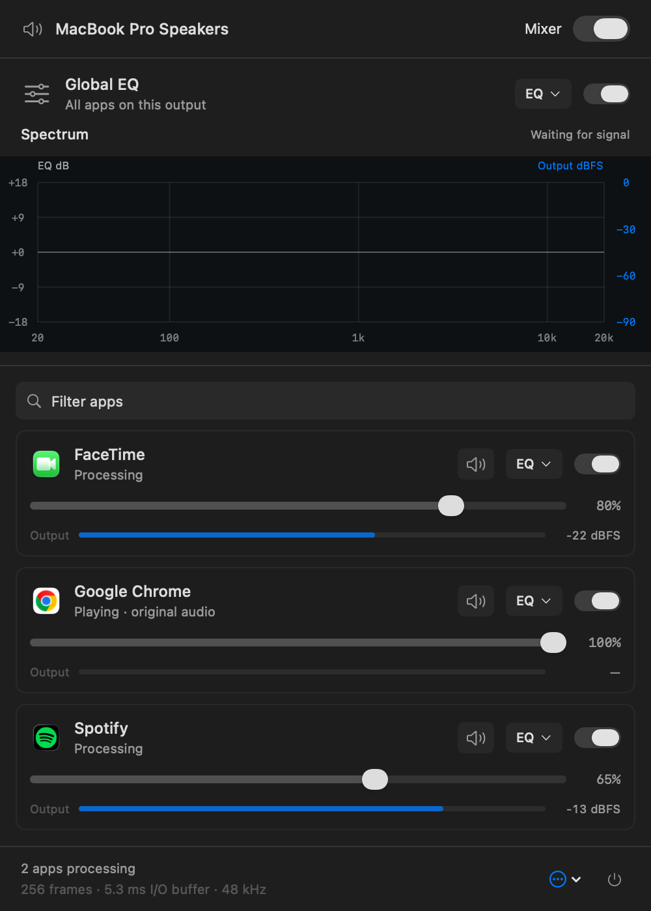
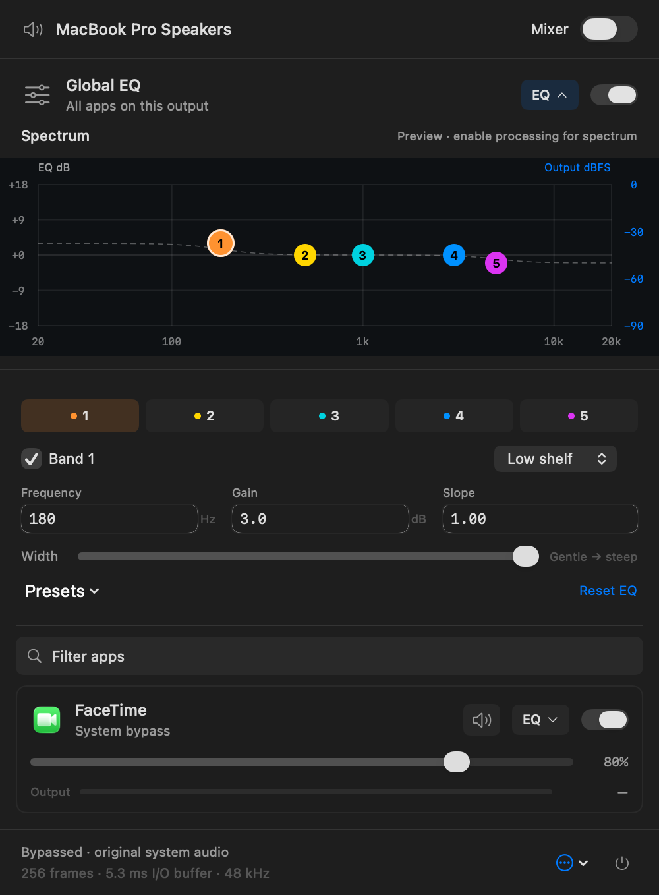

<p align="center">
  
</p>

<h1 align="center">QEQ</h1>
<p align="center"><strong>Quick EQ</strong><br>Per-app mixer and equalizer for macOS.</p>
<h2 align="center"><a href="https://github.com/gh123man/QEQ/releases">Download</a></h2>
<p align="center">macOS 14.4+ · Apple Silicon & Intel · Signed and notarized releases</p>

<p align="center">
  
  
</p>
<p align="center"><sub>Native interface shown with sample app settings and levels.</sub></p>

## Features

- Global and per-app five-band EQ, independent volume, and quick mute.
- Draggable curves, 11 presets, and layered live app spectra.
- Per-app bypass and one switch to restore system audio.
- A menu bar panel that fits your app list, scrolling only when needed.
- Direct audio processing without added playback buffers or installed drivers.

## Get started

Open the DMG, drag **QEQ** to Applications, and launch it. Start playback, click the sliders in the menu bar, adjust an app, then enable the mixer.

Allow **system-audio capture** when macOS asks. No microphone, Accessibility, or screen capture permission is needed. Every launch starts bypassed.

## Build

Requires Xcode and Homebrew.

```sh
brew bundle
./run.sh
```

[Development, testing & releases](docs/DEVELOPMENT.md) · [Third-party notices](THIRD_PARTY_NOTICES.md)
