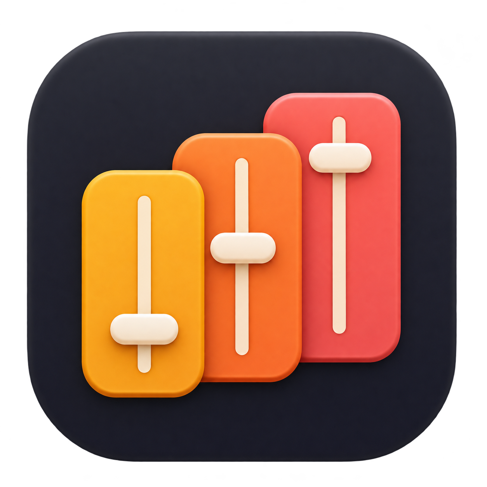
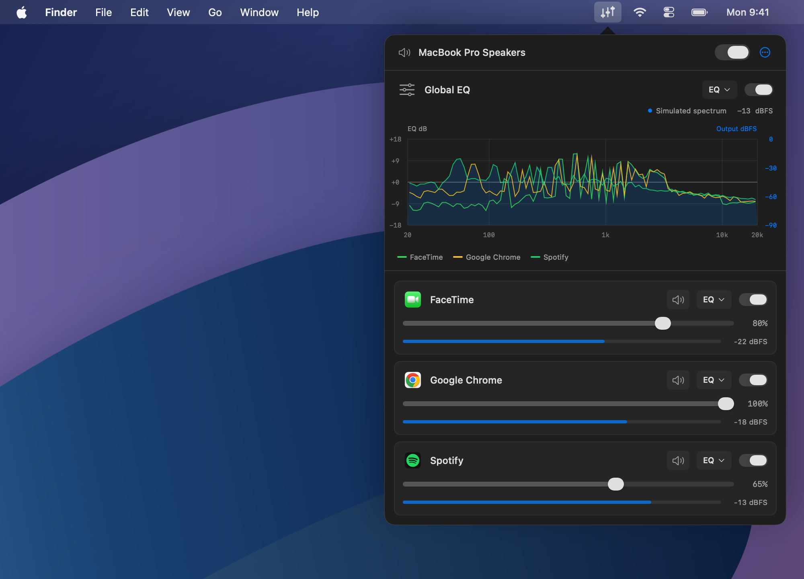
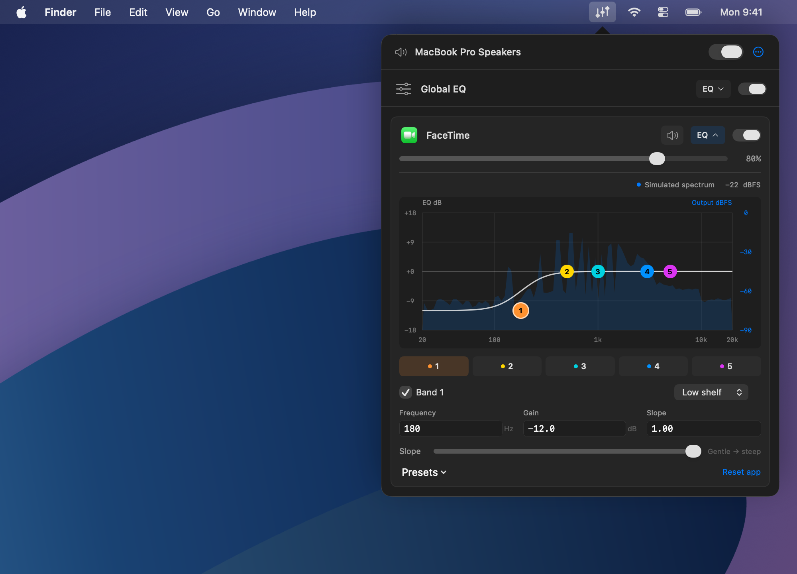

  

<h1 align="center">QEQ</h1>

<strong>Quick EQ</strong> Per-app mixer and equalizer for macOS.

<h2 align="center"><a href="https://github.com/gh123man/QEQ/releases">Download</a></h2>

macOS 14.4+ · Apple Silicon & Intel

  

Illustrated desktop; real app UI with simulated spectra.

Per-app equalizer

## Features

- Global and per-app five-band parametric EQ.
- Independent app volume and quick mute.
- 11 presets, draggable EQ curves, and live spectra.
- Per-app bypass and one switch to restore system audio.

## Get started

Drag **QEQ** from the DMG to Applications and launch it. Play audio, click the sliders in the menu bar, and adjust an app. Allow **system-audio capture** when macOS asks.

[Development](docs/DEVELOPMENT.md) · [Third-party notices](THIRD_PARTY_NOTICES.md)
